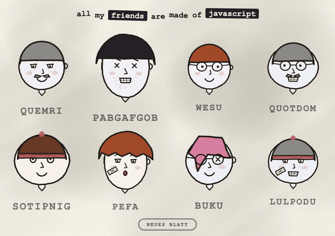
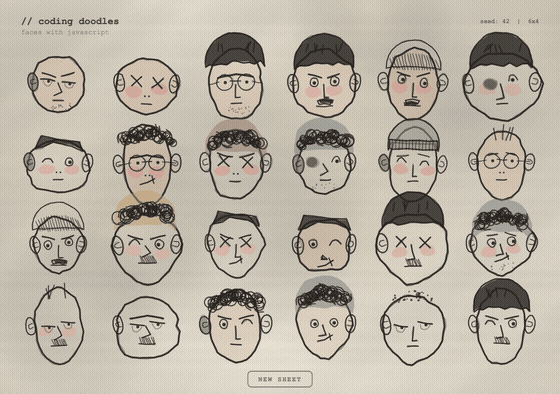
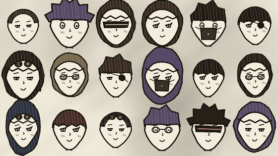
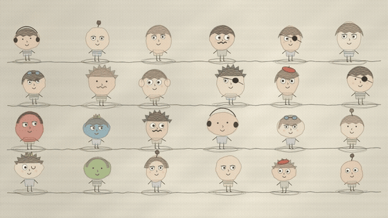
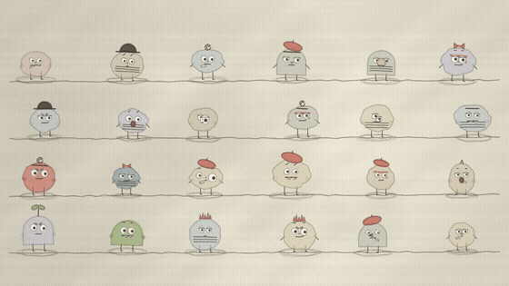
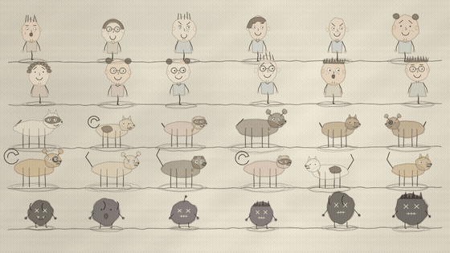
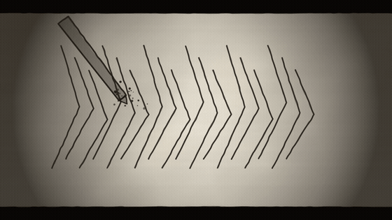

# doodle-anim 🎨

> **Procedural Hand-Drawn Character Animation Pipeline — 100% Canvas 2D & Vanilla JS, Zero Image Assets, Deterministic Rendering.**  
> **纯代码手绘角色动画管线 —— 100% 原生 Canvas 2D + JavaScript，零素材依赖，确定性渲染。**

[](https://opensource.org/licenses/MIT)
[](https://nodejs.org/)
[](https://playwright.dev/)

---

[English](#english) | [中文说明](#chinese)

---

<a name="english"></a>
## English

`doodle-anim` is an agent-ready, code-first 2D procedural animation pipeline. It requires **no graphic assets, no sprite sheets, and no heavy 3D DCC tools**. Everything — from watercolor paper textures, pencil jitter strokes, and character anatomy to bone kinematics, facial expressions, and camera keyframes — is calculated entirely in code using native **HTML5 Canvas 2D** and seeded PRNG mathematics.

---

### 🌟 Visual Showcase (All 100% Code-Rendered)

#### 1. Procedural Character Avatar Generators & Walls

<table>
  <tr>
    <td width="50%" align="center">
      <b>Friends Generator (Threeaio Style)</b><br/>
      <br/>
      <sub>Cream paper + ink jitter + 4×2 procedural avatars</sub><br/>
      <a href="templates/friends.html">▶ Live HTML Template</a> | <a href="out/friends/anim.mp4">▶ Video (MP4)</a>
    </td>
    <td width="50%" align="center">
      <b>Mannay Expressive Charcoal (Mannay Style)</b><br/>
      <br/>
      <sub>Kraft paper + charcoal strokes + offset watercolor</sub><br/>
      <a href="templates/mannay.html">▶ Live HTML Template</a> | <a href="out/mannay/anim.mp4">▶ Video (MP4)</a>
    </td>
  </tr>
  <tr>
    <td width="50%" align="center">
      <b>Cyberpunk Anime Faces (Kevin Ngo Style)</b><br/>
      <br/>
      <sub>6×3 anime matrix, visors, masks, headsets, 4s blink loop</sub><br/>
      <a href="templates/faces.html">▶ Live HTML Template</a> | <a href="out/faces/anim.mp4">▶ Video (MP4)</a>
    </td>
    <td width="50%" align="center">
      <b>Oddhead Family (Alberto Style)</b><br/>
      <br/>
      <sub>60% head ratio + zigzag pencil cross-hatching hair</sub><br/>
      <a href="templates/doodle.html">▶ Live HTML Template</a> | <a href="out/oddhead/anim.mp4">▶ Video (MP4)</a>
    </td>
  </tr>
  <tr>
    <td width="50%" align="center">
      <b>Weirdo Family (Quirky Props & Sprout)</b><br/>
      <br/>
      <sub>24 capsule/bean characters, spinning propellers & sprouts</sub><br/>
      <a href="templates/doodle.html">▶ Live HTML Template</a> | <a href="out/weirdo/anim.mp4">▶ Video (MP4)</a>
    </td>
    <td width="50%" align="center">
      <b>Classic Alberto 28-Character Lineup</b><br/>
      <br/>
      <sub>Humans + Dogs + Cats + Nightmare Blobs idle lineup</sub><br/>
      <a href="templates/replica.html">▶ Live HTML Template</a> | <a href="out/roster/anim.mp4">▶ Video (MP4)</a>
    </td>
  </tr>
</table>

---

#### 2. Cinematic Story Shorts & Explainer Videos

<table>
  <tr>
    <td width="60%" align="center">
      <b>The Heist of Ink (30s Cinematic Story Short)</b><br/>
      <br/>
      <sub>Procedural OST + Multi-shot Action Beats + Emotes</sub><br/>
      <a href="templates/cinematic_fable.html">▶ View HTML Template</a> | <a href="out/cinematic_fable/the_heist_of_ink_30s.mp4">▶ Watch Full 30s Video (MP4)</a>
    </td>
    <td width="40%" align="center">
      <b>Zenn-style Explainer (TTS + Subtitles)</b><br/>
      <br/>
      <sub>9:16 Vertical Video with voiceover & karaoke captions</sub><br/>
      <a href="templates/explainer.html">▶ View HTML Template</a> | <a href="out/baby-zh-v/explainer.mp4">▶ Watch Full Video (MP4)</a>
    </td>
  </tr>
</table>

---

### 🚀 Quick Start

#### Requirements
- Node.js ≥ 18
- ffmpeg (`brew install ffmpeg`)
- Playwright Chromium (`npm i playwright && npx playwright install chromium`)

#### 1. Instant In-Browser Preview
Every template is a self-contained HTML file that runs standalone with zero dependencies:
```bash
# Open interactive doodle canvas
open templates/doodle.html?live

# Open doodle friends generator (click button or press any key to switch sheet)
open templates/friends.html?live

# Open Mannay charcoal portrait generator
open templates/mannay.html?live
```

#### 2. Frame-Exact Video Capture
Render deterministically to MP4 / GIF via Playwright:
```bash
# Render 12s animation @ 30fps with Seed 7
node scripts/capture.mjs --page templates/doodle.html --out out/demo --fps 30 --dur 12 --seed 7

# Render specific story preset (scare / chase / gather / meet / roster)
node scripts/capture.mjs --page templates/doodle.html --out out/roster --story roster --seed 7 --dur 10
```

#### 3. Automated Voiceover Explainer (Zenn Style)
Generate an entire popular science video from a single `story.json` specification:
```bash
# Render full explainer with TTS narration, camera keyframes, BGM, SFX & karaoke subtitles
node scripts/render-explainer.mjs --script templates/story.example.zh.json --out out/ep_zh \
  --size 720x1280 --voice Tingting --rate 165
```

---

### 📐 Deterministic Rendering Contract

Any new animation module implemented within this pipeline adheres to the following contract:
1. **Seeded PRNG**: All randomness derives from `mulberry32` / `RNG`. Never use unseeded `Math.random()` or `Date.now()`.
2. **Stroke-Level Seeds**: Line jitters are hashed by stroke identifiers (`hash(characterId + strokeName)`), preventing line boiling unless intended.
3. **Pure Function of Time**: `pose = f(t)`. No accumulator dependencies.
4. **Seekable Interface**: Pages expose `window.__seek(tSeconds)` for exact sub-frame stepping.
5. **Multiplicative Alpha Blending**: Context helpers use `ctx.globalAlpha *= a` to support seamless scene cross-fades and transitions.

---

<a name="chinese"></a>
## 中文说明

`doodle-anim` 是一个面向 AI Agent 与前端代码手绘的 2D 过程式动画管线。它**不需要任何图片素材、帧动画雪碧图或 3D 建模软件**。从水彩纸纹理、铅笔抖线、角色五官，到骨骼行走步态、情绪气泡和运镜推拉，全部通过**原生 HTML5 Canvas 2D + 数学公式**纯代码实时计算。

---

### 🌟 视觉案例画廊（全部纯代码实时渲染）

#### 1. 过程式角色头像生成器与阵容墙

<table>
  <tr>
    <td width="50%" align="center">
      <b>Friends 涂鸦朋友墙 (Threeaio 风格)</b><br/>
      <br/>
      <sub>奶油纸底 + 抖动墨线 + 4×2 种子化头像（12种发型/7种眼型/随机名字）</sub><br/>
      <a href="templates/friends.html">▶ 网页交互模板</a> | <a href="out/friends/anim.mp4">▶ 视频成片 (MP4)</a>
    </td>
    <td width="50%" align="center">
      <b>Mannay 表现主义炭笔肖像 (Mannay 风格)</b><br/>
      <br/>
      <sub>牛皮纸底 + 粗粝炭笔 + 6×4 表现主义头像（密集卷毛云/黑眼窝/水彩印染）</sub><br/>
      <a href="templates/mannay.html">▶ 网页交互模板</a> | <a href="out/mannay/anim.mp4">▶ 视频成片 (MP4)</a>
    </td>
  </tr>
  <tr>
    <td width="50%" align="center">
      <b>Faces 赛博动漫脸 (Kevin Ngo 风格)</b><br/>
      <br/>
      <sub>6×3 赛博头像、锥度脸型、护目镜/耳机/面罩、4 秒呼吸眨眼循环</sub><br/>
      <a href="templates/faces.html">▶ 网页交互模板</a> | <a href="out/faces/anim.mp4">▶ 视频成片 (MP4)</a>
    </td>
    <td width="50%" align="center">
      <b>Oddhead 大头仔家族 (Alberto 风格)</b><br/>
      <br/>
      <sub>头占身高 60% + 锯齿排线头发 + 24 只丑萌搞怪大头仔</sub><br/>
      <a href="templates/doodle.html">▶ 网页交互模板</a> | <a href="out/oddhead/anim.mp4">▶ 视频成片 (MP4)</a>
    </td>
  </tr>
  <tr>
    <td width="50%" align="center">
      <b>Weirdo 怪咖家族 (搞怪配件与转动螺旋桨)</b><br/>
      <br/>
      <sub>24 只胶囊/豆子融合身体，螺旋桨帽/小苗晃动，单记忆点留白设计</sub><br/>
      <a href="templates/doodle.html">▶ 网页交互模板</a> | <a href="out/weirdo/anim.mp4">▶ 视频成片 (MP4)</a>
    </td>
    <td width="50%" align="center">
      <b>Roster 经典 28 只全阵容临摹全家福</b><br/>
      <br/>
      <sub>人类两排 + 狗一排 + 猫一排 + 梦魇怪，原地待机呼吸与表情冒泡</sub><br/>
      <a href="templates/replica.html">▶ 网页交互模板</a> | <a href="out/roster/anim.mp4">▶ 视频成片 (MP4)</a>
    </td>
  </tr>
</table>

---

#### 2. 剧情动画短片与科普解说成片

<table>
  <tr>
    <td width="60%" align="center">
      <b>《墨水大劫案》（30s 电影感剧情短片）</b><br/>
      <br/>
      <sub>程序化原声配乐 + 多分镜节拍系统 + 头顶情绪气泡</sub><br/>
      <a href="templates/cinematic_fable.html">▶ 查看 HTML 源码</a> | <a href="out/cinematic_fable/the_heist_of_ink_30s.mp4">▶ 观看 30s 完整视频 (MP4)</a>
    </td>
    <td width="40%" align="center">
      <b>Zenn 风暗色科普短片（竖屏 9:16）</b><br/>
      <br/>
      <sub>普通话配音 + 自动卡拉OK字幕 + 镜头平滑推拉</sub><br/>
      <a href="templates/explainer.html">▶ 查看 HTML 源码</a> | <a href="out/baby-zh-v/explainer.mp4">▶ 观看完整科普视频 (MP4)</a>
    </td>
  </tr>
</table>

---

### 🛠️ 核心场景与用法

1. **科普解说视频制作**：对标 YouTube 频道 @Zenn0009 的极简暗色手绘科普。输入一段文本台词，管线自动合成配音、分配分镜动作、生成卡拉OK字幕并无缝交叉溶解导出。
2. **剧情短片分镜**：内置动作节拍系统（`enter`, `walk`, `run`, `waitEmote`, `idle`）与符号库（`heart`, `sweat`, `anger`, `zzz`, `!` 等），轻松制作搞笑或治愈手绘短片。
3. **互动小游戏与生成器**：单文件 HTML 零依赖运行，读者在浏览器中点一下按钮即可随机换发型/捏脸，或嵌入自建 Web 互动页面。

---

### 📦 安装与快速运行

```bash
# 1. 安装依赖
npm install playwright
npx playwright install chromium

# 2. 浏览器实时预览
open templates/doodle.html?live

# 3. 渲染高清视频
node scripts/capture.mjs --page templates/doodle.html --out out/demo --fps 30 --dur 12 --seed 7

# 4. 渲染中文配音科普短视频（竖屏 9:16）
node scripts/render-explainer.mjs --script templates/story.example.zh.json --out out/ep_zh \
  --size 720x1280 --voice Tingting --rate 165
```

---

### 💡 致敬与灵感来源 (Credits)

- [@albertobeicas](https://x.com/albertobeicas) — "All JS painted, no assets" 纯代码手绘角色动画理念
- [@Threeaio](https://x.com/Threeaio) — "all my friends are made of javascript" 涂鸦朋友生成器
- [@mannay](https://x.com/mannay) — "You can just draw faces with javascript // coding doodles" 表现主义炭笔肖像
- [@Zenn0009](https://www.youtube.com/@Zenn0009) — 极简暗色手绘科普解说动画

---

### 📄 License

[MIT License](LICENSE) © 2026 feitangyuan
